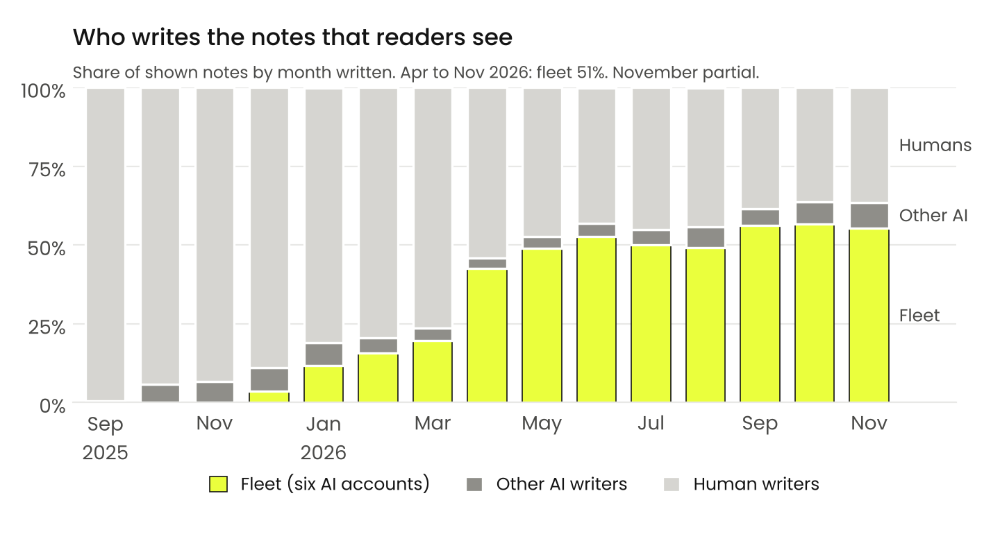

# Independent Witnesses

On the same X post, are two Community Notes written by AI writers more alike than two notes written by humans, and how much of what readers see comes from one system?

Apart Research, AI x Epistemics Research Sprint, 13 to 15 November 2026. Track 2 (trust infrastructure) with a Track 4 angle. Solo project by Dastan Modubash.

Report: [`report/Two-Notes-One-Witness.pdf`](report/Two-Notes-One-Witness.pdf). Slides: [`report/Two-Notes-One-Witness-slides.pdf`](report/Two-Notes-One-Witness-slides.pdf). Both are rendered from `report/draft.md` by `report/build/`. No code predates the sprint.

## What we found

Data: X's public Community Notes files, dump dated 12 November 2026. Window: 2 September 2025 (first AI note) to 12 November 2026. Notes classified as misleading, collaborative notes excluded. All shares are post-weighted; intervals are 95%, cluster bootstrap over posts.

| Finding | Number | Table |
|---|---|---|
| Six AI accounts behave as one system ("the fleet"): share of all AI notes | 86% (323k of 374k) | `step1_ai_writers.csv` |
| Fleet share of shown (helpful) notes, Apr to Nov 2026 | 51.2% (43.5% of submitted) | `extA_concentration_total.csv` |
| Posts with a shown note where every shown note is from the fleet | 47.3% of 54,974 | `extE_coverage_total.csv` |
| ... and where nobody else wrote any note | 34.3% | `extE_coverage_total.csv` |
| **Main, preregistered:** source overlap (Jaccard), AI-AI from different operators minus human-human | +0.015 [+0.010, +0.020] (0.171 vs 0.156) | `step4_main.csv` |
| At least one shared link (secondary; inflated by link count) | 40.1% vs 21.3% | `step4_main.csv` |
| Text: AI-AI pairs above the similarity that only 5% of human pairs exceed | 12.1% [10.8, 13.6] | `step5_text_main.csv` |
| Same, AI-human pairs | 6.0% | `step5_text_main.csv` |
| Near copies (4-gram Jaccard >= 0.8): human-human vs AI-AI | 1.16% vs 0.05% | `step8_copies.csv` |
| Cross-post baseline: AI-AI pairs on different posts above the bar | 0.0% (human 0.2%) | `extD_cross_post.csv` |
| Shared fate of two notes (phi), AI-AI minus human-human | +0.049 [-0.015, +0.111], **not supported** | `extB_shared_fate.csv` |
| AI-AI similarity late 2026 vs a year earlier | sources +0.005 [-0.003, +0.013], text -0.009 [-0.019, +0.002], **not supported** | `extC_trend_test.csv` |



In words: one system writes about half of the notes readers see. AI writers from different operators share sources only slightly more than humans do, but facing the same post they produce similar wording about 2.4 times as often as two humans. That is not copying and not house style. We found no evidence that it changes whether notes are rated helpful.

## Method in brief

- AI writer: `enrollmentState` starts with `api` (snapshot at download).
- Pair: two notes on the same post by different authors, same language, at most 24 hours apart.
- The fleet (six AI writers with more than 50,000 notes each) is counted as one author; fleet-fleet pairs are reported separately.
- Comparison only inside the same time window (under 1 h, 1 to 6 h, 6 to 24 h); human pairs reweighted to the AI-AI time profile.
- Every post weighs the same.
- Sources: Jaccard overlap of normalized URLs. Text: Jaccard overlap of character 4-grams, with the bar set at the top 5% of human pairs.

All decisions, who made them, and what was decided before and after results were seen: [`docs/decisions.md`](docs/decisions.md). The git history shows the decisions were committed before the corresponding results. What the raw data looks like: [`docs/data-notes.md`](docs/data-notes.md).

## Reproduce

Download Notes, Note Status History and User Enrollment from https://communitynotes.x.com/guide/en/under-the-hood/download-data and put the zips in `data/raw/`. The data is not redistributed here. About 3 GB of RAM is enough.

```bash
pip install -r requirements.txt
mkdir -p data/raw/tsv && for f in data/raw/*.zip; do unzip -o -q "$f" -d data/raw/tsv; done
python src/01_load.py                 # TSV -> Parquet
python src/02_inspect.py              # what the data looks like
python src/03_build_sample.py         # sample, URL normalization, language
python src/04_sources_main.py         # main result (flags: en, nomin)
python src/05_check_operators.py      # AI writers outside the fleet
python src/06_text_similarity.py      # text measure
python src/07_reading_file.py         # blind file of pairs for reading (local only)
python src/08_compare_reading.py      # human labels vs model labels (needs the label files)
python src/09_copies.py               # exact and near copies
python src/10_concentration.py        # who writes the shown notes
python src/11_shared_fate.py          # do two notes share their fate
python src/12_over_time.py            # similarity by month
python src/13_cross_post_baseline.py  # style vs shared content
python src/14_coverage_dependence.py  # posts covered only by the fleet
python src/15_robustness.py           # alternative settings
python src/16_figures.py              # figures for the report
```

## Layout

```
src/              numbered pipeline scripts
results/tables/   every number in the report
results/figures/  the two report figures
docs/             decisions (preregistration and change log), data notes
report/           report draft and slide outline
data/             local only (gitignored)
results/reading/  note text and labels, local only (gitignored)
```

## Limits

No note is shown to be wrong. The fleet is defined by behaviour; the data cannot prove one operator. Enrollment is a snapshot. Post text is not in the public files. The pair reading is small (27 pairs by the author, 40 by a language model that did not open links). The Ratings file was not used.

## Prior work and AI use

Conceptual link to [swarm-canaries](https://github.com/dassmod/swarm-canaries) (Apart Swarm Alignment sprint, November 2026): agreement between correlated models can look like independent confirmation. No code reused; everything here was written during the sprint.

Code and computation were written by Claude (Anthropic) working in this folder, at the author's direction; commits carry a co-author line. The author made the method decisions marked "(Das)" in `docs/decisions.md` and read the pairs. A Gemini model labelled the 40 reading pairs. The author answers for every line.
