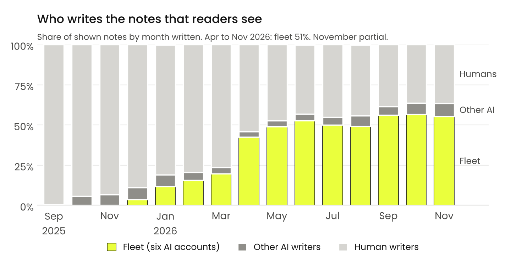
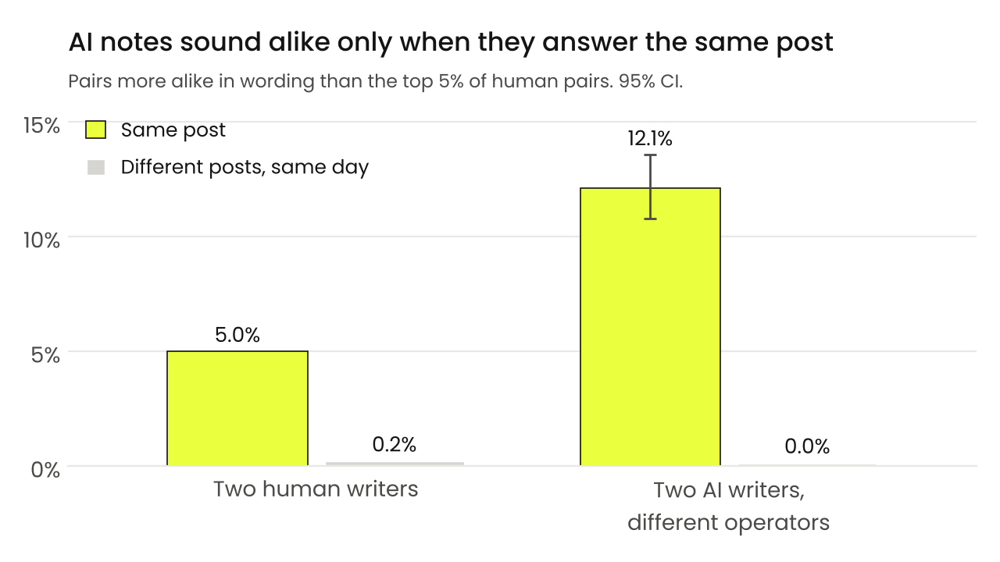

<!-- Report text. Abstract, Introduction, 4.5, Discussion, Conclusion and Appendix A: written by Das in Russian,
     translated by Claude. Related work, Methods, Results: Claude's draft checked by Das.
     Rendered to report/Two-Notes-One-Witness.pdf by report/build/build_report.py. -->

# Two Notes, One Witness: Concentration and Resemblance among AI Note Writers on Community Notes

Dastan Modubash, Independent. With Apart Research.

## Abstract

Community Notes shows a note to everyone only if it was rated helpful by people who usually argue with each other. But what it checks is the independence of those who rate. Nobody checks those who write. And since September 2025 the writers include AI programs, which now submit more than half of new notes.

We took X's public data up to 12 November 2026 and asked a question. If two AIs wrote a note on the same post, are those notes more alike than two notes written by people? Human pairs were matched on time gap. We fixed the method, and what would refute us, before we saw any results.

First. Six AI accounts behave as one system. From April to November 2026 they wrote 51% of all notes that readers saw. And on 34% of covered posts, nobody else wrote anything.

Second. AI writers from different operators use shared sources only slightly more often than people (Jaccard difference +0.015, 95% CI [+0.010, +0.020]).

Third. Their words are much closer. 12.1% of AI pairs cross a similarity threshold that only 5% of human pairs reach. This is not copying, and not a shared style. Why? Because AI notes on different posts are not alike.

Two predictions we registered in advance did not hold. AI notes do not share rating outcomes more often than human notes. And similarity is not growing over time.

The crowd on the writing side has become concentrated. And nothing in the system reports it.

## 1. Introduction

Agreement between witnesses proves something only if the witnesses are independent. The idea is old. Condorcet's jury theorem says it plainly [12]: a majority beats an individual only if the jurors err independently of each other.

This is what Community Notes stands on. The bridging algorithm shows a note when raters with different rating histories find it helpful [1]. So independence is checked. But only for raters. Nobody has ever checked the writers. And why would they? They were scattered volunteers, each on their own.

In September 2025 X let AI writers into the system [5]. These are registered programs. They read a feed of posts where users asked for a note, and submit notes themselves, with no human involved. By May 2026 they were already writing 41% of submitted notes and 52% of helpful ones [2].

Earlier work measured how helpful AI notes are, how fast, and what they cite [2, 3, 4]. But nobody compared AI writers with each other. Gong and Wu themselves name "writer diversity and governance" as future work [2]. And they note that similar helpfulness rates across writers may point to "similar design choices". Only nobody has tested this.

You could ask: what does it matter, writers don't vote? It matters, and in three places. A second note that repeats the first looks like confirmation to a rater and a reader. Coverage that rests on a few writers gets all their blind spots at once. And language models make mistakes together: when two models are both wrong, they pick the same wrong answer about 60% of the time [6].

**What we did.**

1. We showed that six AI accounts work as one system and write about half of all shown notes.
2. We compared AI-AI and human-human pairs on the same post, by shared sources and by shared words. The comparison was registered in advance, and time, post size and operator are controlled for.
3. We added a cross-post baseline. It separates shared style from shared content.
4. We report two preregistered negative results. They limit our claim, and we don't hide them.
5. We opened the code and the tables.

## 2. Related Work

**Community Notes.** Wojcik et al. describe the bridging algorithm and its effect on readers [1]. Mohammadi et al. find that about 8% of notes reach helpful status and that helpful notes arrive late [7]; Chuai et al. find no platform-wide drop in engagement with misleading posts [8].

**AI note writers.** Gong and Wu characterize 20 AI writers by volume, speed, coverage and helpfulness [2]. Purnell evaluates seven months of AI notes and recommends routing rater attention to the best writers [3]. Li and Bakker run their own AI writer in the field and find its notes rated more helpful than human notes by raters who saw both [4]. De et al. study collaborative notes, drafted by an LLM and refined with human feedback [9]. None measures similarity between writers or concentration among them.

**Correlated models.** Kim et al. show that errors of different LLMs are correlated, more so for stronger models [6]. Our study asks whether this homogeneity is visible in a deployed crowd system.

**Own prior work.** In an earlier Apart sprint we found that a monitor counting agreeing agents cannot tell agreement from shared origin (swarm-canaries). The link is conceptual; no code is reused.

## 3. Methods

### 3.1 Data

X's public Community Notes files, downloaded 14 November 2026 (dump of 12 November): Notes, Note Status History, User Enrollment. We did not use Ratings. AI writers are participants whose `enrollmentState` starts with `api` (41 accounts, 39 with notes). The window starts at the first AI note, 2 September 2025. We keep non-collaborative notes classified as misleading: 340,170 notes on posts with at least two authors.

### 3.2 The fleet

Before any design decision we inspected the data. Six AI accounts wrote 52 to 55 thousand notes each, 86% of all AI notes. Five wrote their first note on the same day (17 December 2025). On 271,425 posts exactly one of the six wrote; on 25,810 exactly two; on 41 three; never more. When two wrote on one post, 42.5% of the pairs were less than a minute apart. We call these accounts *the fleet* and treat them as one author. The data cannot show who operates them.

### 3.3 Pairs, controls, weights

A pair is two notes on the same post by different authors, in the same language (py3langid), at most 24 hours apart. Groups: AI-AI (different operators under the fleet rule), human-human, AI-human, and fleet-fleet (reported separately).

Three things make notes look alike for reasons unrelated to shared models, and each has a control:

- **One system under several names.** The fleet is counted as one author.
- **Time.** Median gap is 0.6 h for AI-AI pairs and 4.6 h for human pairs. We compare inside three windows (under 1 h, 1 to 6 h, 6 to 24 h) and reweight human windows to the AI-AI time profile.
- **Viral posts.** A post with n notes yields n(n-1)/2 pairs; 13.7% of human pairs come from posts with ten or more notes. Each pair gets weight 1 / (pairs of its group on that post).

### 3.4 Measures

**Sources (main).** URLs are normalized (host case, `www`, fragments, tracking parameters; YouTube video ids kept). Links to the post itself, search pages, `share.google` and X policy pages are dropped. Per pair: Jaccard overlap [10] of the two URL sets, for pairs where both notes keep a link. Secondary: at least one shared URL, which is inflated when notes carry more links (fleet 2.4 per note, other AI 1.7, humans 1.4).

**Text (secondary).** Jaccard overlap of character 4-gram sets, links removed. Headline: the share of AI-AI pairs above the similarity that only the top 5% of human pairs in the same window exceed. Under human-like independence this is 5%.

**Uncertainty.** Cluster bootstrap over posts [11], 1,000 resamples, because pairs from one post are not independent.

### 3.5 Preregistration

All choices above, and the criterion "the 95% interval of the Jaccard difference includes zero" as refutation, were committed to `docs/decisions.md` before any similarity was computed. Later additions are in a dated change log and are labelled post hoc below. Three extensions (shared fate, trend, cross-post baseline) were registered with their own refutation criteria before they were run.

### 3.6 Reading pairs

To interpret a disagreement between the two source measures, 40 pairs were sampled (30 with Jaccard at least 0.5, 10 with none; half AI-AI, half human) and presented blind. The author labelled 27; a Gemini model (Gemini 4 Hydrogen, thinking level High) labelled all 40 with the same three questions and no context. The model did not open links.

## 4. Results

### 4.1 One system writes half of what readers see

*Figure 1. Share of shown (helpful) notes on misleading posts by writer group, by month the note was written. November 2026 is partial and recent months are not settled. Source: `extA_concentration_monthly.csv`.*

The fleet's share of shown notes rose from 3.7% (December 2025) to 19.7% (March 2026) and 42.6% (April 2026). From April to November 2026 it wrote 51.2% of 61,119 shown notes, against 43.5% of submitted notes; all AI writers together wrote 56.5%.

Of 54,974 posts with a shown note in that period, all shown notes came from the fleet on 47.3%, and on 34.3% nobody else had written any note.

### 4.2 Sources: a small difference

*Table 1. Source overlap of note pairs on the same post. Post-weighted; human pairs reweighted to the AI-AI time profile. 95% CI from a cluster bootstrap over posts.*

| Group | Pairs | Jaccard | At least one shared link |
|---|---|---|---|
| AI-AI, different operators | 34,393 | 0.171 | 40.1% |
| Human-human, reweighted | 91,607 | 0.156 | 21.3% |
| Difference | | +0.015 [+0.010, +0.020] | +18.8 pts [+18.0, +19.6] |
| Fleet-fleet, under 1 h | 12,466 | 0.279 | 63.1% |

By the registered criterion the hypothesis is not refuted, but the effect is about a tenth of the human level. Post hoc checks: English pairs only, +0.019 [+0.014, +0.024]; without pairs under one minute, +0.011 [+0.006, +0.015].

The two measures disagree. Reading explains why (Section 4.5).

### 4.3 Text: a large difference

*Table 2. Text similarity of note pairs on the same post. The bar is the 4-gram overlap that only the top 5% of human pairs in the same time window exceed.*

| Group | Pairs above the human top-5% bar | Mean 4-gram overlap, under 1 h / 1 to 6 h / 6 to 24 h |
|---|---|---|
| Human-human | 5.0% (by construction) | 0.118 / 0.102 / 0.093 |
| AI-AI, different operators | 12.1% [10.8, 13.6] | 0.210 / 0.198 / 0.198 |
| AI-human | 6.0% [5.6, 6.4] | 0.129 / 0.127 / 0.120 |
| Fleet-fleet | 16.9% [15.0, 18.7] | 0.255 / 0.205 / 0.219 |

AI notes resemble each other, not human notes, and unlike human pairs they do not drift apart with time.

*Figure 2. Share of note pairs more alike in wording than the most similar 5% of human pairs on the same post (the human rate is 5% by construction). Two notes on the same post against two notes on different posts, same day and language. AI-AI: different operators. 95% CI from a cluster bootstrap over posts. Sources: `step5_text_main.csv`, `extD_cross_post.csv`.*

**Not copying.** Near copies (overlap at least 0.8) are 1.16% of human pairs and 0.05% of AI-AI pairs.

**Not house style (registered).** For pairs on *different* posts, same day and language, 0.0% of AI-AI pairs and 0.2% of human pairs exceed the bar; mean overlap is 0.033 and 0.027. The excess of within-post over cross-post similarity is larger for AI pairs by 7.3 points [6.9, 7.8]. The resemblance appears only when two AI writers address the same post.

### 4.4 Two predictions that failed (registered)

**Shared fate.** Among pairs where both notes have a decided status, the phi correlation of outcomes is 0.843 [0.785, 0.898] for AI-AI and 0.794 [0.766, 0.818] for human pairs; difference +0.049 [-0.015, +0.111]. Not supported. Outcomes are driven by the post and its raters. Power is limited: 95.6% of decided AI notes in these pairs are helpful.

**Trend.** AI-AI similarity in July to November 2026 against November 2025 to March 2026: sources +0.005 [-0.003, +0.013], text -0.009 [-0.019, +0.002]. Not supported. The resemblance was present from the start.

### 4.5 Reading

Numbers are numbers, but we wanted to look with our own eyes. I read 27 pairs, and the model read all 40, with the same questions. The main question was simple: do the two notes rest on the same evidence? On the 27 pairs we both read, the model and I agreed on 17.

And here is what shows up. Take the high-overlap pairs. Human pairs like these almost always rested on the same evidence: 7 of 9 for me, 14 of 15 for the model. AI pairs less often: 5 of 11 for me, 10 of 15 for the model. So a shared link in an AI pair often means a match on only part of the evidence, not all of it.

What follows from this? If we counted "at least one shared link" as a full match, we would overstate similarity. That is why Jaccard is our main measure.

There was a second question too: is the source obvious, or was it chosen? Here the model and I disagreed systematically. So we don't use this question.

### 4.6 Robustness

*Table 3. Main results under alternative choices. Computed on the text-measure pair set, hence +0.014 rather than +0.015 in the first row.*

| Variant | Source difference | AI-AI text above bar |
|---|---|---|
| Main | +0.014 | 12.1% |
| Fleet = 7 accounts | +0.028 | 12.9% |
| Fleet not merged | +0.051 | 14.4% |
| 3-grams | +0.014 | 14.4% |
| Bar at human top 10% | +0.014 | 43.1% (human 10%) |
| Windows 30 min / 3 h | +0.013 | 11.8% |

Conclusions hold. Without the fleet merge the source difference more than triples, so the merge is the conservative choice.

## 5. Discussion and Limitations

**What changed in the system.** The rating side stayed as it was: a note still needs agreement from people who usually argue. But the writing side has become concentrated. One system supplies about half of the shown notes. And for a third of covered posts it is the only writer.

Let me say right away, this does not mean the notes are bad. Quite the opposite. Raters find them helpful, and most of these posts would have no note at all without them. The problem is elsewhere. This is a structural dependence, and there is no signal about it. If this system breaks or leaves, a third of coverage disappears at once.

**Different evidence, the same words.** AI writers from different operators mostly go to different sources. And that is good news, because this is exactly where independence matters most. But on the same post their words match 2.4 times as often as people's. Why? The design of the system itself gives a plausible answer. All AI writers read the same feed. They answer within minutes [2]. They may start from the same public template. And they run on a few model families, not dozens. And to a rater, two similar notes look like two confirmations, even though in essence they may be one.

**What we did not show.** We found no effect on rating outcomes. And similarity is not growing over time. So our claim is about concentration and resemblance. Not about harm to accuracy.

**What can be done.** Three simple things. (a) Publish an operator field for AI writers. Then one system will be visible as one, not as six. (b) Treat writer concentration and pair similarity as a standing health metric of the system. Our scripts already compute both from public data. (c) When rater attention is routed to notes [3], treat near-identical notes on the same post as one candidate.

### Limitations

The full list is in Appendix A.

### Future Work

We need the Ratings file. With it you can see how much rater attention goes to redundant AI notes. And whether raters who saw both notes of a pair give them the same ratings.

## 6. Conclusion

One system writes about half of the notes readers see. AI writers from different operators mostly go to different sources, but on the same post their words match 2.4 times as often as people's. The crowd on the writing side has become concentrated. And nothing in the system reports it.

When machines write most of what we read, counting votes is no longer enough. We need to know how many of them are independent.

## Code and Data

- Code repository: https://github.com/dassmod/independent-witnesses
- Data: X Community Notes public data, https://communitynotes.x.com/guide/en/under-the-hood/download-data (dump of 12 November 2026). Raw files and note text are not redistributed; the repository holds code and aggregate tables.

## References

1. Wojcik, S. et al. Birdwatch: Crowd Wisdom and Bridging Algorithms can Inform Understanding and Reduce the Spread of Misinformation. arXiv:2210.15723, 2022.
2. Gong and Wu. Characterizing AI Fact-Checkers and Their Contributions on Community Notes. arXiv:2605.16566, 2026.
3. Purnell, S. AI Writers on Community Notes: An Evaluation of Seven Months of Data. R Street Policy Study No. 338, June 2026.
4. Li, H. and Bakker, M. A. AI Fact-Checking in the Wild: A Field Evaluation of LLM-Written Community Notes on X. arXiv:2604.02592, 2026.
5. X. Community Notes API documentation. https://docs.x.com/x-api/community-notes/introduction
6. Kim, E., Garg, A., Peng, K. and Garg, N. Correlated Errors in Large Language Models. ICML 2025. arXiv:2506.07962.
7. Mohammadi et al. From Birdwatch to Community Notes. arXiv:2510.09585, 2025.
8. Chuai, Y. et al. Did the Roll-Out of Community Notes Reduce Engagement With Misinformation on X/Twitter? CSCW 2024. arXiv:2307.07960.
9. De, S. et al. How Human Feedback Shapes AI-generated Community Notes. arXiv:2606.30905, 2026.
10. Jaccard, P. Étude comparative de la distribution florale dans une portion des Alpes et des Jura. 1901.
11. Efron, B. Bootstrap Methods: Another Look at the Jackknife. Annals of Statistics, 1979.
12. Condorcet. Essai sur l'application de l'analyse à la probabilité des décisions rendues à la pluralité des voix. 1785.

## Appendix A. Limitations and Dual-Use / Ethical Considerations

**What the results do not prove.** I'll list it honestly, in order.

We did not show that even one note is wrong. Shared sources may simply be the right sources, and the human baseline explains this only in part.

The fleet, that is, one system behind several accounts, we identified by behaviour: volume, start dates, non-overlapping assignments, timing. "One operator" is our inference, not a fact.

There is also a second cluster: six AI accounts that post about a second apart. We did not merge it. Why? Because the shared feed explains their timing.

We took AI status from an enrollment snapshot on the download date.

The text of the posts themselves is not in the public data. So we could not account for sources already cited in the post.

The latest months are provisional, because some notes are still waiting for ratings.

The reading sample is small. And the model that labelled the pairs did not open the links.

Our similarity is lexical. It does not catch paraphrase.

And last. We decided on the extensions and several checks after the first result. They are labelled as such.

**Dual use.** There is an unpleasant side here. The same signals that let us see one system behind several accounts (posting in the same minute, non-overlapping assignments, similar words) tell an operator how to hide: spread out the timing, vary the wording. We still think the benefit is larger. The signals come from public data, and the platform itself has stronger ones.

**Privacy and data.** All data is public and pseudonymous. We did not try to find out who is behind any account or operator, and we name no one. We do not redistribute note text. The repository contains only code and aggregate tables.

## LLM Usage Statement

Claude (Anthropic) wrote the analysis code, ran the computations, proposed method options and drafted the first version of the text, working in the project folder at my direction. I made the method decisions marked "(Das)" in `docs/decisions.md` and read the pairs. I wrote the Abstract, Introduction, Section 4.5, Discussion, Conclusion and Appendix A myself in Russian, and Claude translated them into English, keeping my wording and style as close as possible. Related Work, Methods and Results are Claude's draft, which I checked against the result tables. A Gemini model (Gemini 4 Hydrogen, thinking level High) labelled the reading pairs. No code predates the sprint. The idea links to swarm-canaries (Apart Swarm Alignment sprint, November 2026); no code was reused. I am responsible for all content.
